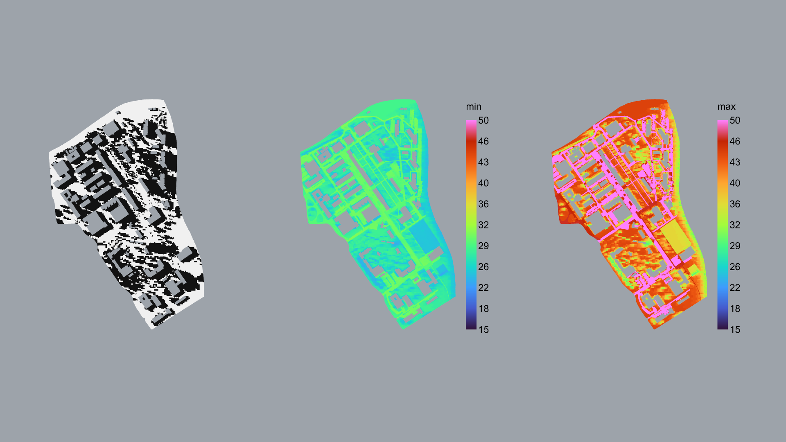

# ICEtool-gh

Rhino/Grasshopper port of [ICEtool](https://github.com/Art-Ev/ICEtool) (QGIS plugin, v2026.07) for estimating urban surface temperatures — Urban Heat Island (UHI) analysis directly on Rhino geometry.


The per-point energy-balance solve runs **natively inside Grasshopper** via Rhino 8 Python 3 script components backed by the pure-Python package [icetool_gh](icetool_gh). No server, no conda environment, no Hops: scipy/numpy/pandas are auto-installed into Rhino's CPython by the components' `# r:` directives on first run (internet needed once). Ladybug Tools must be installed in Grasshopper for the weather import, the sun study and the heatmap.

### How it works

One Grasshopper definition, `ee_icetool.gh`, self-contained : 



- One **ScriptEditor v3 file-synced** component : its code lives in [gh](gh) on disk and reloads automatically when edited — no embedded copies. (Component output index 0 is the reserved `out` stdout param — keep it there.)
- **Minimal interface**: both components take only `run, mat_ids, sun, epw_file, month, day, db_path`. Grasshopper's job is geometry + the Ladybug shadow study; **all weather is read from the EPW file directly** (dry bulb, humidity, radiation, wind, infrared, site location).
- **Materials** come from the bundled v2026.07 database ([icetool_gh](icetool_gh)`/data/Material_database.csv`, vendored from upstream). Layer names under `materials::<ID>` must match the `ID` column. `FixedTemp[degC]` entries (e.g. water) bypass the solve, as in QGIS.
- **QGIS-compat component**: reproduces upstream ICEtool Step 4 exactly (hc = 5 W/m²K, one 24 h representative day, Fuentes sky temperature, Cableizer ground temperature, Penman-Monteith evapotranspiration with fixed 1 km/h wind, |ΔT| < 0.5 °C convergence). Toggle `run compat` to use it.
- **Solver component**: same equations with **EPW-derived refinements** — hourly wind-derived `hc` (McAdams, EPW 10 m wind → 2 m) instead of constant 5; sky temperature from the EPW's measured horizontal infrared radiation instead of the Fuentes correlation; Penman-Monteith with real hourly wind; Fuentes fallback clamped below 0 °C so winter/full-year runs survive. Feed 8760 h sun trees for a full-year solve. (The Python API additionally exposes `hc`, `incident_rad_Wh_m2` and `tint_override_C` for custom runs.)

### Install / Run

Requirements for Grasshopper use:

- **Rhino 8** (the components are Python 3 ScriptEditor components).
- **[Ladybug Tools](https://www.ladybug.tools/) for Grasshopper** — the definition uses `LB Import EPW`, `LB Direct Sun Hours` (the shadow study) and `LB Spatial Heatmap`. Install it with the Pollination installer or Rhino's package manager before opening the file.
- **Internet on the first solve** — the components' `# r: numpy, scipy, pandas` directives make Rhino pip-install those packages into its own CPython the first time they run. Later runs are offline (the EPW can be local; the Paris EPW option in the weather Value List downloads it).

Then open `ee_icetool.gh`, pick the example and weather in the Value Lists, click the Data Dam once, and set the run toggle. No server, no conda environment, no QGIS.

### Headless use (no Rhino)

The same solver runs from a shell through `scripts/solve.py`, a self-contained script (its dependencies are declared inline, so [uv](https://docs.astral.sh/uv/) installs them on the fly; with plain `python` install the packages of `pyproject.toml` first). Sun-exposure fractions, which the Ladybug shadow study supplies on the canvas, are given as one constant (`--sun`) or per point and hour (`--points`):

```bash
uv run scripts/solve.py --epw data/ToulouseWeatherData.epw --materials CC3,VG1 --month 7 --day 1
```

It prints a JSON summary (min/mean/max per point) and writes the hourly curves as CSV with `--output`. `--help` documents the points-file format and the exit codes; `--list-materials` lists the material IDs.

### Validation against QGIS version

Numerical parity with QGIS Step 4 (see [docs/qgis-vs-gh.md](docs/qgis-vs-gh.md) for full detail): agreement ≤0.05 °C/hour at the code level against a vendored, drift-guarded copy of the upstream physics; 0.005 °C against the actual QGIS plugin output with identical inputs (INSA-Toulouse, July 1). Through the **full GH pipeline** (the QGIS-replica example scene + Toulouse EPW, 47 414 points, Ladybug shading): hottest 24 h curve within **0.009 °C**, temperature distribution percentiles within ~0.3–1.9 °C of QGIS across min/mean/max, most-shaded points within ~0.4 °C — remaining differences are Ladybug-vs-UMEP shading (canopy opacity, grid), not physics.

### Repository layout

* [icetool_gh](icetool_gh) — solver package (physics, solver with built-in dedup, materials, EPW reader, vendored material DB).
* [gh](gh) — the two file-synced script-component files (thin mode wrappers) + `_glue_common.py` (the shared component body: goo unwrap, tree orientation, EPW load, solve, output marshalling).
* [scripts](scripts) — `solve.py`, the headless command-line entry point to the solver.
* `ee_icetool.gh` (repo root) — the definition, alongside `data/` — a custom demo scene (`simple-example.3dm`) and the Toulouse EPW. The INSA-Toulouse QGIS-replica scene is generated locally (not shipped in the repo).
* `pyproject.toml` — Python version and dependency bounds of the solver package.
* [docs/icetool-qgis.md](docs/icetool-qgis.md) — analysis of the upstream plugin's source.
* [docs/qgis-vs-gh.md](docs/qgis-vs-gh.md) — QGIS-vs-GH comparison and parity status.

### License & attribution

ICEtool-gh is a derivative work of [ICEtool](https://github.com/Art-Ev/ICEtool) by Arthur Evrard (Egis / INSA Toulouse):

> Evrard, Arthur. *ICEtool: a QGIS plugin to compute ground temperatures and quantify urban heat islands.* Egis / INSA Toulouse. https://github.com/Art-Ev/ICEtool

